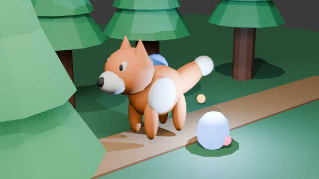

# AI Cartoon Studio 3D

[](https://github.com/AsimAslah/AI-Cartoon-Studio/actions/workflows/ci.yml)

An open-source, local-first 3D cartoon creation studio powered by Blender, Python, and FastAPI. This v0.1 foundation creates a reusable procedural fox and magical forest, extracts TXT/PDF/DOCX story text, generates a constrained rule-based storyboard, and invokes Blender for genuine renders.

> Development status: [v0.1.0](https://github.com/AsimAslah/AI-Cartoon-Studio/releases/tag/v0.1.0) is released and the v0.2 storyboard editor is merged. The `feat/malayalam-lipsync-engine` branch adds a validation and preview foundation, but **no real lip-sync provider is configured**. This project does not claim arbitrary text-to-3D generation, animal lip-sync, natural motion capture, or universal story understanding.



## Working features

- Automatic Blender discovery on Windows and safe background subprocess execution
- Procedural orange fox with white belly, eyes, four legs, tail, and blue backpack
- Procedural magical forest, glowing stone, lighting, camera, and keyframed motion
- Genuine editable `.blend`, 640×360 PNG, and short MP4 output
- Direct story entry and validated TXT, text-PDF, and DOCX upload (5 MB limit)
- Deterministic storyboard for one fox, one forest, and six basic actions
- Responsive FastAPI web interface and lightweight pytest suite

## v0.2.0 editor capabilities

The storyboard editor implementation is merged but remains unreleased until a version is explicitly published:

- Edit descriptions, narration, optional dialogue, supported characters/actions, environments, and durations
- Add, delete, and reorder scenes with versioned schema validation
- Create, list, reopen, and update local JSON projects using UUIDs and atomic writes
- Reject corrupt data, unsupported schema versions, unsafe project IDs, unsupported assets, and invalid scene order
- Submit a validated single scene to a one-worker Blender render queue
- Report honest `QUEUED`, `PREPARING`, `STARTING_BLENDER`, `RENDERING`, `FINALIZING`, `COMPLETED`, and `FAILED` states
- Preview and download an MP4 only after genuine output validation

## Project status

- **COMPLETED:** v0.1.0 procedural fox/forest foundation, story extraction, constrained storyboards, verified Blender rendering, tests, CI, and first public release.
- **MERGED, NOT RELEASED:** v0.2.0 storyboard editor, versioned scene validation, and JSON project persistence.
- **IN DEVELOPMENT:** Malayalam lip-sync Milestone 1—validated local uploads, previews, provider discovery, and truthful job contracts.
- **PLANNED:** real GPU-backed inference, multi-scene rendering, narration/audio, more reusable assets, and optional video providers.

## Malayalam Lip-Sync Studio — Milestone 1

The browser can validate and preview either a character image or MP4 together with the original Malayalam WAV/MP3. **Save prepared upload** stores the exact validated bytes under an ignored UUID directory in `project_data/lipsync_uploads/`. Filenames, size limits, signatures, UUID paths, metadata, and preview retrieval are validated.

The provider selector reports researched LatentSync, MuseTalk, and external-GPU options, but none is configured on the default integrated-Radeon system. Generation stays disabled and no model is downloaded, no cloud media is sent, and no paid call is made. A passing validation is not proof of lip-sync. See [Milestone 1](docs/LIPSYNC_MILESTONE1.md) and [provider research](docs/LIPSYNC_PROVIDER_RESEARCH.md).

## Windows setup

Requirements: Windows 11, Python 3.10+, and Blender 4.2+ or 5.x. No CUDA GPU is required.

```powershell
cd C:\Users\asima\Documents\AI-Cartoon-Studio
.\.venv\Scripts\Activate.ps1
python -m pip install -r requirements.txt
uvicorn app.main:app --reload
```

Open `http://127.0.0.1:8000`. Keep the development server bound to loopback; lip-sync upload endpoints reject non-local clients. Upload or edit a story, generate the storyboard, then render a preview. Scanned PDFs need OCR and are rejected when no selectable text is present.

### Storyboard and saved projects

Generate scenes, edit their fields, use the arrow controls to reorder them, then select **Validate storyboard**. Project JSON files are stored locally in the ignored `project_data/` directory. **Save project** creates a UUID-backed project; subsequent saves update it atomically. **New copy** creates a new ID on the next save.

Rendering currently accepts exactly one supported scene lasting 1–10 seconds. Multi-scene storyboards can be edited and saved, but video sequencing is not yet implemented and is never silently replaced by the fixed demonstration.

## Render the demonstration

```powershell
& 'C:\Program Files\Blender Foundation\Blender 5.3\blender.exe' --background --factory-startup --python scripts\fox_scene.py -- --output-dir output
```

This writes `output/forest_fox.blend`, `output/preview.png`, and `output/first_cartoon.mp4`. Rendering is intentionally short and low resolution for laptop hardware. Blender bundles the FFmpeg encoder used by this script; a separate FFmpeg executable is not required for this milestone.

## Tests

```powershell
python -m pytest
```

Unit tests do not run expensive Blender renders. The command above is the local end-to-end smoke test.

## Architecture

FastAPI owns validation and the browser workflow. Deterministic services extract documents and map supported phrases into a typed storyboard. The Blender runner launches a self-contained `bpy` script, which creates assets, animation, and verified output. See [architecture](docs/ARCHITECTURE.md) and the [roadmap](docs/ROADMAP.md).

The versioned HTTP API is documented in [docs/API.md](docs/API.md). Lip-sync Milestone 1 endpoints are documented in [docs/LIPSYNC_MILESTONE1.md](docs/LIPSYNC_MILESTONE1.md). Interactive OpenAPI documentation is available at `http://127.0.0.1:8000/docs` while the server is running.

## Contributing and license

See [CONTRIBUTING.md](CONTRIBUTING.md). Licensed under the [MIT License](LICENSE). The CI badge reflects GitHub Actions status only; it is not a GitHub profile achievement.
